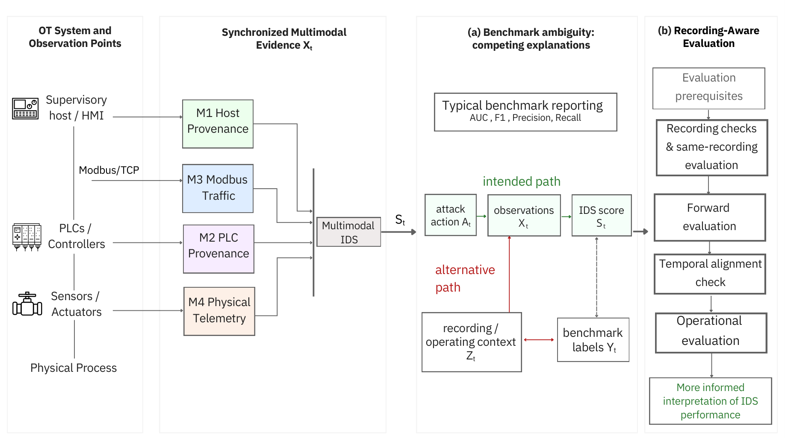

# Recording-Aware Evaluation of Multimodal OT Intrusion Detection

Code and saved results for:

> **Recording-Aware Evaluation of Multimodal OT Intrusion Detection**  
> Mustafa Umut Ozbek, Khalil El-Khatib, and Li Yang  
> Ontario Tech University

Accepted for presentation at **ICSS 2026**.

<p align="center">
  
</p>

*Figure 1. Multimodal OT evidence and recording-aware evaluation. The
[original PDF](results/paper_figures/figure1_recording_aware_evaluation.pdf) is
the canonical figure; the image above is a display preview.*

> **Artifact scope.** This release contains saved results, verification code,
> and educational notebooks with visible outputs. It is a **saved-results
> replay package**, not a complete raw-data-to-training pipeline or a deployed IDS.

> **Data notice.** Raw ProvICS and HAI captures are not included. Dataset
> attribution and use terms are separate from the code license; see
> [THIRD_PARTY_NOTICES](THIRD_PARTY_NOTICES).

## Study overview

The paper examines whether IDS performance partly reflects differences between
recordings rather than attack-specific behavior. ProvICS provides four views:
supervisory-host provenance (M1), controller provenance (M2), decoded Modbus
traffic (M3), and physical-process telemetry (M4).

The analysis compares attack windows against two background populations: a
separate benign recording and background from the same attack recording. It
also examines recording separability before labeled attacks, campaign-ordered
results, temporal alignment, fusion, and alarm burden. HAI is a smaller external
scope check, not evidence that the ProvICS findings apply to every OT benchmark.

## Where the artifacts came from

The original experiments ran in Google Colab. This package retains the saved
result tables, selected score arrays, matching window metadata, frozen
specifications, and paper figures from that work. Notebook outputs were saved
by replaying these released artifacts locally; they are not training logs.

Internal reports, private working archives, raw captures, and model checkpoints
are excluded. The full manuscript PDF is also excluded from this code release.

## Layout

```text
.
├── assets/                  README figure preview
├── configs/                 replay settings and frozen specifications
├── data_manifest/           source manifest, event labels, artifact checksums
├── notebooks/               eight step-by-step notebooks with saved outputs
├── results/
│   ├── paper_tables/        saved CSV tables supporting the paper
│   ├── paper_figures/       three canonical figure PDFs
│   └── frozen_scores/      selected scores and window metadata
│       └── score_grid/     metadata paired with the score arrays
├── src/                     replay, screening, metric, and fusion utilities
├── tests/                   artifact-integrity and consistency checks
├── requirements.txt
├── CITATION.cff
├── LICENSE
└── THIRD_PARTY_NOTICES
```

## How the files map to the paper

| Paper component | Released artifacts | Walkthrough |
|---|---|---|
| Dataset inventory and feature screening | `data_manifest/`, frozen feature lists, inventory metadata | Notebook 01 |
| Recording checks and modality ranking | `window_sensitivity_summary.csv`, `session_probe_results.csv` | Notebook 03 |
| Operating-state support check | `operating_support_summary.csv` and supporting variable-level tables | Notebook 03 |
| Fusion and alarm behavior | `physical_anchor_comparison.csv`, `fusion_conditioning_results.csv`, `event_matching_sensitivity.csv` | Notebook 04 |
| Reference audit, temporal summaries, and calibration sensitivity | `v6_forward_partition_audit.csv`, `temporal_nulls*.csv`, `calibration_bootstrap.csv` | Notebook 05 |
| Supervised-model check | `supervised_robustness.csv` | Notebook 05 |
| HAI external check | `hai_portable_core_full.csv` | Notebook 06 |
| Buffer sensitivity and recorded numerical summaries | `supervisor_buffer_sensitivity_*.csv`, `tests/expected_results.json` | Notebook 07 |

The CSV files in this table are under `results/paper_tables/` unless another
directory is given. The synthetic-control tables are also retained there.

## Notebooks

Start with **00**, then follow the numbered notebooks. Saved tables and plots
can be inspected without rerunning the cells.

| Notebook | Purpose |
|---|---|
| [00 — Setup and reproducibility](notebooks/00_setup_and_reproducibility.ipynb) | Check settings, environment information, and artifact checksums |
| [01 — Data inventory and schema checks](notebooks/01_data_inventory_and_schema_checks.ipynb) | Separate inventory and score grids, check score/metadata dimensions, and inspect feature screening |
| [02 — Windowing and feature construction](notebooks/02_windowing_and_feature_construction.ipynb) | Inspect the recorded window settings and feature definitions; no feature extraction |
| [03 — Recording checks and same-recording evaluation](notebooks/03_recording_checks_and_same_recording_evaluation.ipynb) | Read the saved recording comparisons and modality rankings |
| [04 — Fusion and operational evaluation](notebooks/04_fusion_and_operational_evaluation.ipynb) | Compare saved fusion results, event matching, and alarm burden |
| [05 — Forward and temporal evaluation](notebooks/05_forward_and_temporal_evaluation.ipynb) | Inspect the separate historical-reference audit and saved temporal/calibration summaries |
| [06 — HAI external scope check](notebooks/06_hai_external_scope_check.ipynb) | Inspect reference-dependent differences without treating reused files as independent replications |
| [07 — Verify paper tables and figures](notebooks/07_reproduce_paper_tables_and_figures.ipynb) | Check 20 recorded numerical summaries and display the canonical paper figures |

Rerunning the notebooks reads existing artifacts and creates disposable exports
under `results/regenerated/`. It does not train detectors, generate new randomized
schedules, or run a new bootstrap experiment. Canonical tables and figures are
not overwritten.

## Saved scores and matching metadata

The `A_M*_w*.npz` files contain per-window `attack` and `benign` score arrays
for **seed 42**. The summary tables include the five original fit seeds
42–46; the other four seeds' per-window arrays are not included.

Pair each array with its metadata at the same resolution, in saved row order:

```text
A_M1_w60.npz["attack"]  → score_grid/meta_attack22h_w60.parquet
A_M1_w60.npz["benign"]  → score_grid/meta_benign48h_w60.parquet
```

Both paths are relative to `results/frozen_scores/`. The same pairing applies
to M2–M4 and the 5-, 10-, and 30-second arrays.

The older `window_meta_attack22h.parquet` and `window_meta_benign48h.parquet`
describe the **inventory grid**, not the score-array grid. They are retained for
the paper's dataset accounting. At 60 seconds, inventory counts are 1,246/3,117
attack/benign windows, while score-grid counts are 1,261/3,121. Do not substitute
one grid for the other.

Per-modality availability masks are not included. The supplied metadata support
row alignment, but are not sufficient on their own to reconstruct every
modality-specific AUC from the score arrays. The notebooks check the reported
summaries from the saved tables.

## Reference data and interpretation

The primary window-size and fusion comparisons fit on the first 70% of the
separate benign recording. The fitting partition is also reused for score
standardization and threshold calibration. The remaining 30% supplies the
cross-recording evaluation background.

The action-screened historical-reference audit in
`v6_forward_partition_audit.csv` is a **separate reference construction**. Its
fit/calibration counts are not the partitions behind the primary comparisons.

The supplied timestamps place the attack capture on April 16–17, 2026, and the
benign capture on April 18–20. These fixed-reference comparisons are therefore
retrospective; campaign ordering does not establish that the benign reference
was available before the attacks. No timestamp remapping is performed here.

Alarm-timing and temporal-randomization rerun implementations are not included
in this release. Their saved summaries can be inspected, but this package does
not independently verify all of the original procedure's implementation
constraints. Replaying a table is not an end-to-end validation of its generation.

## Quick start

The saved replay outputs were generated locally with Python 3.12. Notebook 00
records the replay environment's package versions. A GPU and raw datasets are
not required for these notebooks or tests.

For a local checkout on macOS or Linux:

```bash
git clone https://github.com/ANTS-OntarioTechU/Recording-Aware-Evaluation-of-Multimodal-OT-Intrusion-Detection.git recording-aware-ot-ids
cd recording-aware-ot-ids
python3 -m venv .venv
source .venv/bin/activate
python -m pip install -r requirements.txt
python -m pytest -q
```

While the repository is private, cloning requires access through your normal
GitHub authentication. Do not place access tokens in notebooks or saved outputs.

To run the notebooks locally, install JupyterLab in the same environment:

```bash
python -m pip install jupyterlab
export PROVICS_ROOT="$PWD"
jupyter lab notebooks/
```

### Google Colab

1. Copy or clone the repository into your Drive at
   `MyDrive/provics-recording-aware-evaluation`.
2. Open the desired notebook in Colab. Before its regular cells, run:

```python
from google.colab import drive
drive.mount("/content/drive")

import os
os.environ["PROVICS_ROOT"] = "/content/drive/MyDrive/provics-recording-aware-evaluation"
```

```python
%pip install -r /content/drive/MyDrive/provics-recording-aware-evaluation/requirements.txt
```

3. Run the notebook from top to bottom. If your checkout has another name,
   change both paths above. The notebooks themselves use `PROVICS_ROOT` rather
   than requiring the original experiment workspace.

## Verification

The release checks cover file integrity, metadata ordering, score-array lengths,
feature-screening rules, and the 20 recorded numerical summaries. The current
package passes **118 tests** and verifies **67 artifact checksums**. These are
software and saved-artifact checks, not new detector experiments.

The three canonical figure PDFs are in [results/paper_figures/](results/paper_figures/).
Notebook 07 displays previews; it does not redraw the scientific figures from
raw observations. The README preview is kept separately under `assets/`.

## Dataset sources

- **ProvICS:** [TruCyberLab's dataset repository](https://huggingface.co/datasets/trucyberlab/multimodal-ICS-provenance),
  analyzed revision `18b4b0e1359d3d02347301c55f97c3d98f5dab5c`.
  The dataset card lists CC BY-NC 4.0. The source-file manifest is in
  `data_manifest/provics_download_manifest.csv`.
- **HAI 21.03:** [the HAI maintainers' repository](https://github.com/icsdataset/hai).
  This release includes analysis-result summaries, not raw HAI observations.
  Follow the upstream terms applicable to the dataset release.

Please credit the original datasets separately from this code. See
[THIRD_PARTY_NOTICES](THIRD_PARTY_NOTICES) for attribution and data-use details.

## Citation

If you use the code or results, please cite:

> M. U. Ozbek, K. El-Khatib, and L. Yang, “Recording-Aware Evaluation of
> Multimodal OT Intrusion Detection,” *Industrial Control System Security
> Workshop (ICSS 2026)*, accepted for presentation.

```bibtex
@inproceedings{ozbek2026recordingaware,
  title     = {Recording-Aware Evaluation of Multimodal OT Intrusion Detection},
  author    = {Ozbek, Mustafa Umut and El-Khatib, Khalil and Yang, Li},
  booktitle = {Industrial Control System Security Workshop (ICSS 2026)},
  year      = {2026},
  note      = {Accepted for presentation}
}
```

[CITATION.cff](CITATION.cff) provides machine-readable citation metadata. Update
the citation when final proceedings details become available.

## License

Original repository code and related materials are covered as specified in
[LICENSE](LICENSE), using the MIT license. This does not relicense ProvICS,
HAI, or third-party dependencies. It also does not grant rights to a manuscript
or publisher-formatted paper PDF. Dataset-derived materials retain applicable
upstream terms; see [THIRD_PARTY_NOTICES](THIRD_PARTY_NOTICES).
